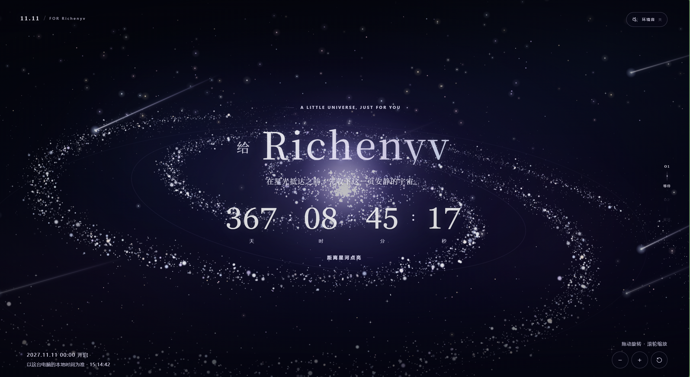

# 星河生日礼物

用姓名和庆祝日期生成一份离线生日网页。蛋糕和祝福在打开设备的本地时间当天零点解锁。

## 脚本用法

将 `generate.py` 和 `template.html` 放在同一目录，用 Python 3.8 或更新版本运行 `python generate.py`，按提示输入姓名和日期。也可直接传参。

```sh
python generate.py "小星" 2027-08-19
```

打开生成的 `dist/星河生日礼物.html` 即可查看或分享。

**再次使用默认文件名时**，请先删除或改名上次生成的 `dist/星河生日礼物.html`，腾出文件名后再运行脚本。也可用 `-o` 指定一个新的输出路径，保留上次生成的网页。

```sh
python generate.py "小星" 2027-08-19 -o "dist/小星的生日礼物.html"
```

`template.html` 内嵌页面样式、脚本及 Three.js 的 MIT 许可。可在其中搜索 `letter-body` 编辑信件正文。

## 效果预览

### 星河倒计时



### 生日祝福


### 星空蛋糕


**禁止商用**
